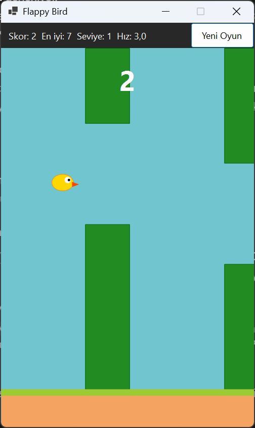
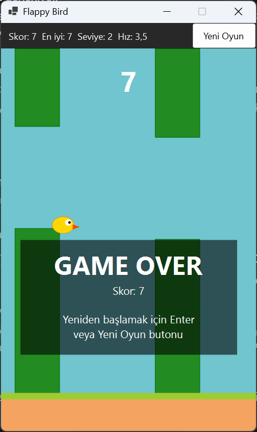

# YMH219-FlappyBird

Windows Forms ile yapılmış Flappy Bird benzeri masaüstü oyunu. Kuş yer çekimiyle düşer, oyuncu klavyeyle zıplatır ve sağdan gelen boruların arasından geçirmeye çalışır.

Nesne Tabanlı Programlama (YMH 219) dersi ek uygulama ödevidir.

## Kullanılan Teknolojiler

- C# / .NET 10
- Windows Forms (Timer, Panel üzerinde GDI+ çizim)
- Harici NuGet paketi yoktur

## Kurulum ve Çalıştırma

Gereksinimler: Windows, .NET 10 SDK (Visual Studio 2026 ".NET masaüstü geliştirme" iş yüküyle birlikte gelir).

**Visual Studio ile:** `FlappyBird.slnx` dosyasını açın ve `Ctrl+F5` ile çalıştırın.

**Komut satırıyla:**

```bash
git clone https://github.com/Ebubekir23/YMH219-FlappyBird.git
cd YMH219-FlappyBird
dotnet run --project FlappyBird
```

## Kontroller

| Tuş | İşlev |
|---|---|
| Boşluk, Yukarı Ok, W veya sol tık | Zıpla / oyunu başlat |
| Enter | Oyun bittiyse yeniden başlat |
| Yeni Oyun butonu | Oyunu sıfırla |

## Özellikler

- Yer çekimi ve zıplama fiziği
- Sağdan sola hareket eden 3 boru çifti; ekrandan çıkan boru yeniden konumlanır
- Boru veya zemine çarpınca Game Over ekranı
- Geçilen her boruda skor artışı
- Her 5 skorda seviye atlama ve hız artışı
- En yüksek skorun dosyada saklanması

## Sınıf Yapısı

| Sınıf | Görevi |
|---|---|
| `Models/Kus` | Kuşun konumu, hızı, zıplama ve yer çekimi |
| `Models/Engel` | Üst ve alt boru çifti, hareket ve yeniden konumlanma |
| `Models/OyunDurumu` | Hazır, Oynanıyor ve Bitti durumları |
| `Models/Oyun` | Oyun kuralları: skor, seviye, hız, çarpışma kontrolü |
| `Services/SkorDeposu` | En yüksek skoru dosyaya yazar ve okur |
| `OyunPaneli` | Oyunu çizen çift tamponlu panel |
| `AnaForm` | Timer döngüsü ve klavye/fare olayları |

## Ekran Görüntüleri

Oyun sırasında:



Oyun bittiğinde:



## Bilinen Sınırlamalar

- Oyun hızı Timer aralığına bağlıdır; çok yavaş bilgisayarlarda oyun da yavaşlar.
- Ses efekti yoktur.
- Yalnızca Windows'ta çalışır.

## Geliştirici

Ebubekir Yılmaz – 250541051
